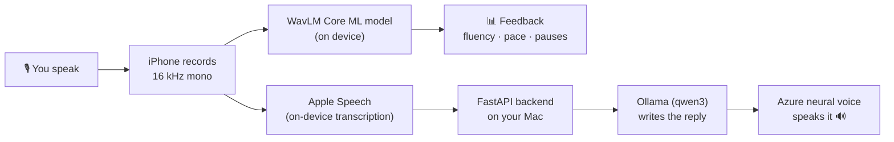

<p align="center">
  
</p>

<h1 align="center">U-Talk 🗣️💚</h1>

<p align="center">
  <b>Practice speaking. At your own pace. Without the pressure.</b><br>
  An iOS app that helps people who stutter rehearse real-life conversations with a friendly AI partner,<br>
  and gives gentle, on-device feedback after every session.
</p>

<p align="center">
  
  
  
  
</p>

<p align="center">
  
</p>

---

## ✨ What is U-Talk?

Ordering food, a job interview, a phone call… everyday moments that can feel huge when you stutter.
**U-Talk turns them into a safe rehearsal space**: pick a situation, talk it through with an AI character who never rushes you,
then see what went well. No audience, no judgement, and **your voice never leaves your iPhone** for the analysis.

## 🎮 Features

| | |
|---|---|
| 🗺️ **Personal roadmap** | A 6-day plan built from the situations *you* said feel hardest during onboarding. Finish a day to unlock the next, and replay any day you've done. |
| 🤖 **AI conversations** | Talk with a waiter, an interviewer, a customer-service agent, an airline agent… Unlimited turns, a hint button when you get stuck. |
| 🎭 **Role-play challenges** | Spin the wheel and become a journalist, a detective or a secret agent. Five story scenarios, each with its own character voice. |
| 📜 **Script practice** | Read a short script aloud, record it, listen back, retry as many times as you like. |
| 📊 **On-device feedback** | Fluency, pace & pauses, and (for scripts) clarity, plus a breakdown of detected speech events, all computed on the iPhone with the Core ML model. |
| 🕓 **Practice history** | Every session saved with the full conversation and its feedback. Delete one or clear everything anytime. |
| 🔔 **Daily reminders** | Optional morning, afternoon or evening reminders themed to your next roadmap lesson. Scheduled locally on the iPhone. |
| 👋 **Talk About Yourself** | A warm “get to know you” chat that greets you by name. |

## 📱 The practice screens

> Design mockups of the practice flow. The numbers shown are sample values, not real results.

<table>
  <tr>
    <td align="center"><br><sub><b>Pick a scenario</b></sub></td>
    <td align="center"><br><sub><b>See the plan</b></sub></td>
    <td align="center"><br><sub><b>Talk with the AI</b></sub></td>
  </tr>
  <tr>
    <td align="center"><br><sub><b>Finish the story</b></sub></td>
    <td align="center"><br><sub><b>Practice a script</b></sub></td>
    <td align="center"><br><sub><b>Get feedback</b></sub></td>
  </tr>
</table>

## 🧠 How it works



**The speech model** is `microsoft/wavlm-base-plus` fine-tuned with LoRA, converted to Core ML.
It listens in 3-second windows and labels each one as *Prolongation, Repetition, Block, Interjection* or *Fluent*.

Verified so far:
- ✅ The trained model runs inside the app and powers the session feedback.
- ✅ The Core ML model matches the original PyTorch model on **422 / 422** UCLASS audio windows (max difference 0.0002).
  This shows the conversion is faithful. It is **not** an accuracy score against ground-truth labels.
- ⚡ Core ML inference took about **25 ms per 3-second window on a MacBook (M4)**. iPhone measurements are still to come.

> 💚 U-Talk is a practice companion. Its feedback is **not** a diagnosis and the model has not been clinically validated.

## 🚀 Run it yourself

### 1. Get the AI model
The Core ML model (~360 MB) is too big for git, so it lives on the Releases page.
1. Download `U_TALK_WavLM.mlpackage.zip` from **[Releases → model-v1](https://github.com/NouraAlGahtani/U-Talk/releases/tag/model-v1)**.
2. Unzip it and put `U_TALK_WavLM.mlpackage` inside the `U-Talk/` folder (next to `ContentView.swift`).

### 2. Run the app
Open `U-Talk.xcodeproj` in Xcode, pick your iPhone, press **⌘R**. 🎉

### 3. Start the AI partner (optional but fun)
Runs on a Mac on the **same Wi-Fi** as the iPhone. Without it, the app still works with built-in sample replies.

```bash
# one-time setup
cd backend
python3 -m venv .venv && source .venv/bin/activate
pip install -r requirements.txt
ollama pull qwen3:8b
security add-generic-password -U -a "$USER" -s utalk-azure-speech -w   # paste your Azure Speech key

# every time
./start_backend.sh
```

Then point the app at your Mac and rebuild (⌘R). Do this again whenever you change Wi-Fi:
```bash
IP=$(ipconfig getifaddr en0) && sed -i '' -E "s#http://[0-9.]+:8000#http://$IP:8000#" U-Talk/Conversation.swift
```

### 🙈 Not in this repo
Python environments, the PyTorch training checkpoint, dataset audio (SEP-28k, UCLASS) and test recordings stay local:
they're huge, covered by dataset licences, or contain someone's voice.

## 🔒 Privacy

- Speech analysis runs **on the iPhone**. Recordings are never uploaded.
- Practice history is stored **only on the device**, as text and numbers. No audio is kept.
- The backend sees only the text of the conversation, so it can write the AI's reply.


<p align="center"><sub>Made with 💚 and a lot of patience. One step at a time.</sub></p>
